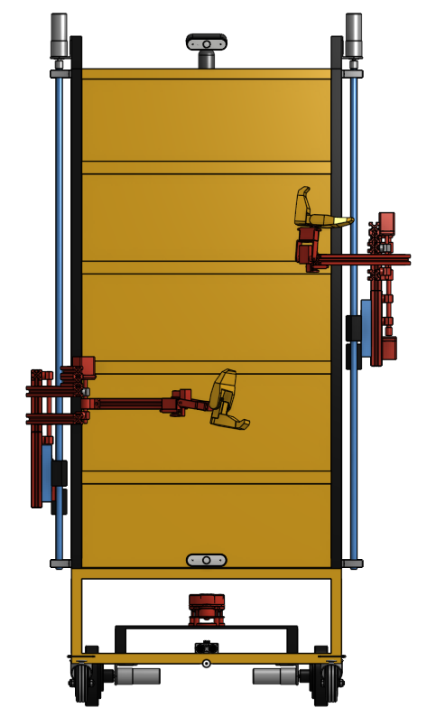
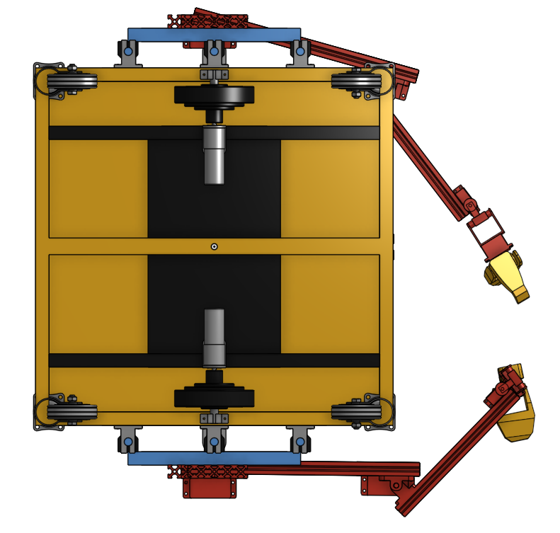
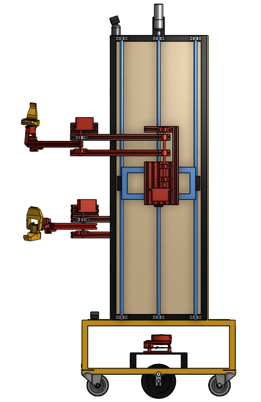
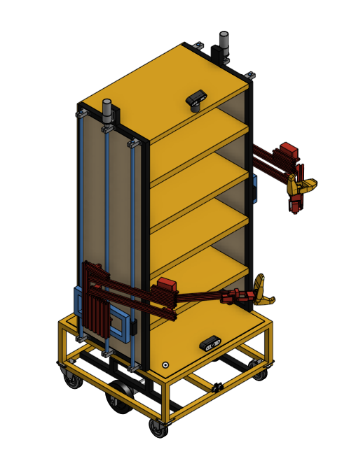
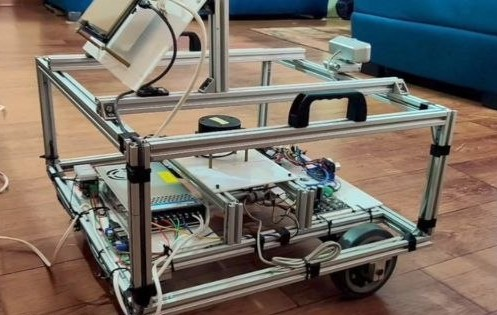
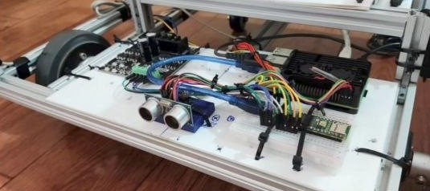
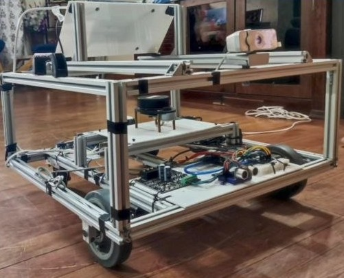
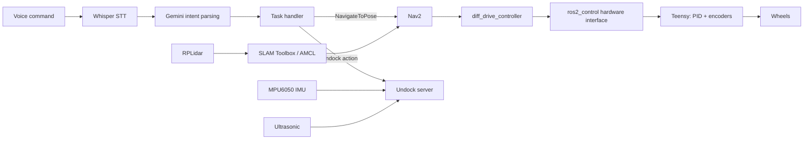

# Sahayak: Autonomous Food Delivery & Serving Robot

A voice-controlled service robot built on **ROS 2**: a differential-drive base with a custom motor-control stack,
SLAM + Nav2 autonomous navigation, and a natural-language voice interface. The robot carries two 6-DOF arms and
storage shelves for transporting and serving food.

## CAD & Mechanical Design

The CAD model of Sahayak features a differential-drive mobile platform, dual articulated robotic arms, and a vertically arranged storage compartment for food transportation and serving.

### Front View

### Top View

### Side View

### Isometric View

## Prototype Development

The project evolved through iterative mechanical design and prototyping, progressing from an initial physical prototype to the current dual-arm mobile manipulator design.

### Initial Prototype

## Features

- **Custom motor control:** Teensy firmware with PID wheel-velocity control on quadrature encoders (100 Hz), connected to ROS 2 through a custom **ros2_control C++ hardware interface** and `diff_drive_controller`.
- **Mapping and localization:** SLAM Toolbox for mapping with an RPLidar, and AMCL for localization on saved maps.
- **Autonomous navigation:** Nav2 with configured costmaps, Smac 2D planner and Regulated Pure Pursuit controller.
- **Custom Nav2 plugins (C++):** Dijkstra and A\* global planners, plus PD and Pure Pursuit local controllers, written with pluginlib. The default config uses Smac 2D + Regulated Pure Pursuit; the custom plugins can be selected in `mobi_navigation/config/`.
- **Voice interface:** Whisper speech-to-text, then Gemini intent classification, then a task handler that sends Nav2 goals (for example "go to the kitchen") or triggers undocking.
- **Undocking action:** custom ROS 2 action server using ultrasonic distance and IMU heading.
- **Perception:** ArUco marker pose-estimation service (OpenCV); MediaPipe face and hand tracking nodes (experimental) that publish joint commands.
- **Simulation:** Gazebo (Ignition) worlds, RViz config, joystick teleop, and a small PyQt5 launcher GUI.

## System overview

## Repository layout

| Package | Purpose |
|---|---|
| `mobi_bringup` | Top-level launch files (simulation and real robot) |
| `mobi_description` | URDF/Xacro model, meshes, Gazebo worlds |
| `mobi_controller` | ros2_control controllers, joystick teleop |
| `mobi_firmware` | Teensy firmware, serial hardware interface, IMU driver |
| `mobi_mapping` / `mobi_localization` | SLAM Toolbox and AMCL/EKF configs, saved maps |
| `mobi_navigation` | Nav2 configuration |
| `mobi_planning` / `mobi_motion` | Custom A\*/Dijkstra planners and PD/Pure Pursuit controllers (Nav2 plugins) |
| `mobi_speech` | Whisper + Gemini voice node |
| `mobi_script` | Task handler and undock action server |
| `mobi_vision` | Camera publisher, ArUco service, face/hand tracking |
| `mobi_msgs` | Custom actions and services |
| `mobi_gui` | PyQt5 launcher |
| `mobi_utils` | Helper nodes |

(The `mobi_` prefix is the internal package name of the robot software.)

