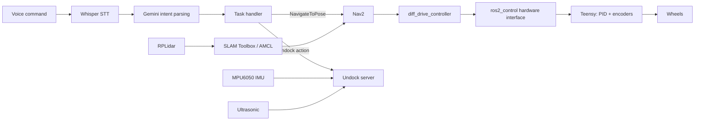

# Sahayak: Autonomous Food Delivery & Serving Robot

A voice-controlled service robot built on **ROS 2**: a differential-drive base with a custom motor-control stack,
SLAM + Nav2 autonomous navigation, and a natural-language voice interface. The robot carries two 6-DOF arms and
storage shelves for transporting and serving food.

<!-- Replace ADD_YOUR_VIDEO_LINK_HERE (below) with your YouTube / Drive video link -->
**[▶ Watch the demo video](ADD_YOUR_VIDEO_LINK_HERE)**

| | |
|---|---|
|  |  |
|  |  |

CAD files and renders are in [`docs/cad/`](docs/cad/).

<!-- Add 1-2 lines about the arms here (how they are driven / what they do), e.g. "Each arm is driven by ..." -->

## Features

- **Custom motor control:** Teensy firmware with PID wheel-velocity control on quadrature encoders (100 Hz), connected to ROS 2 through a custom **ros2_control C++ hardware interface** and `diff_drive_controller`.
- **Mapping and localization:** SLAM Toolbox for mapping with an RPLidar, and AMCL for localization on saved maps.
- **Autonomous navigation:** Nav2 with configured costmaps, Smac 2D planner and Regulated Pure Pursuit controller.
- **Custom Nav2 plugins (C++):** Dijkstra and A\* global planners, plus PD and Pure Pursuit local controllers, written with pluginlib. The default config uses Smac 2D + Regulated Pure Pursuit; the custom plugins can be selected in `mobi_navigation/config/`.
- **Voice interface:** Whisper speech-to-text, then Gemini intent classification, then a task handler that sends Nav2 goals (for example "go to the kitchen") or triggers undocking.
- **Undocking action:** custom ROS 2 action server using ultrasonic distance and IMU heading.
- **Perception:** ArUco marker pose-estimation service (OpenCV); MediaPipe face and hand tracking nodes (experimental) that publish joint commands.
- **Simulation:** Gazebo (Ignition) worlds, RViz config, joystick teleop, and a small PyQt5 launcher GUI.

## System overview



## Repository layout

| Package | Purpose |
|---|---|
| `mobi_bringup` | Top-level launch files (simulation and real robot) |
| `mobi_description` | URDF/Xacro model, meshes, Gazebo worlds |
| `mobi_controller` | ros2_control controllers, joystick teleop |
| `mobi_firmware` | Teensy firmware, serial hardware interface, IMU driver |
| `mobi_mapping` / `mobi_localization` | SLAM Toolbox and AMCL/EKF configs, saved maps |
| `mobi_navigation` | Nav2 configuration |
| `mobi_planning` / `mobi_motion` | Custom A\*/Dijkstra planners and PD/Pure Pursuit controllers (Nav2 plugins) |
| `mobi_speech` | Whisper + Gemini voice node |
| `mobi_script` | Task handler and undock action server |
| `mobi_vision` | Camera publisher, ArUco service, face/hand tracking |
| `mobi_msgs` | Custom actions and services |
| `mobi_gui` | PyQt5 launcher |
| `mobi_utils` | Helper nodes |

(The `mobi_` prefix is the internal package name of the robot software.)

## Quick start (simulation)

Developed for **Ubuntu 22.04 + ROS 2 Humble + Ignition Gazebo**.

```bash
mkdir -p ~/sahayak_ws/src && cd ~/sahayak_ws/src
git clone https://github.com/YOUR_USERNAME/sahayak-robot.git
cd ~/sahayak_ws
rosdep install --from-paths src --ignore-src -r -y
colcon build --symlink-install
source install/setup.bash

ros2 launch mobi_bringup simulated_robot.launch.py
```

This starts Gazebo, the controllers, localization on the `small_house` map, Nav2 and RViz.
Use **2D Goal Pose** in RViz to send the robot somewhere. To build a new map instead:
`ros2 launch mobi_bringup simulated_robot.launch.py use_slam:=true`

### Voice control (optional)

```bash
pip install -r requirements.txt
export GEMINI_API_KEY="your-key"          # required for voice
export ELEVENLABS_API_KEY="your-key"      # optional, spoken replies
ros2 launch mobi_bringup simulated_robot.launch.py use_voice:=true
```

Supported commands: "go to the kitchen", "undock", "stop". API keys are read from environment variables and are never stored in the repo.

## Real robot

```bash
sudo apt install python3-smbus i2c-tools        # IMU
ros2 launch mobi_bringup real_robot.launch.py serial_port:=/dev/ttyUSB0
```

Flash the sketch in `mobi_firmware/firmware/` to the microcontroller first. In `real_robot.launch.py`, navigation, voice and task nodes are commented out by default; enable the ones you need.

## Roadmap

- Autonomous docking (the `Dock` action is defined; the server is not implemented yet)
- Integrating arm control with the navigation stack

## Credits

Simulation worlds use assets from the AWS RoboMaker residential world. Built by Utkarsh.
